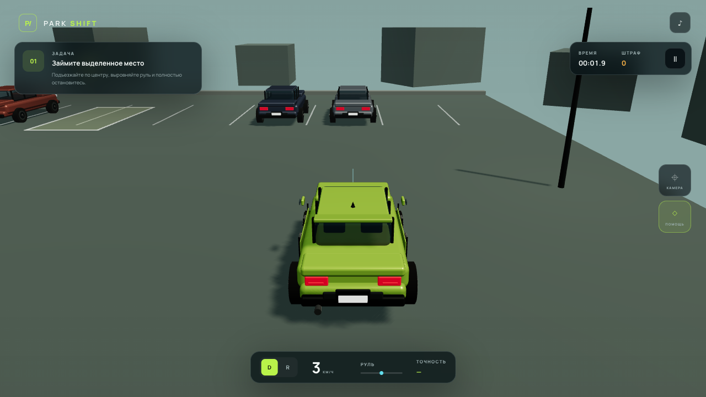
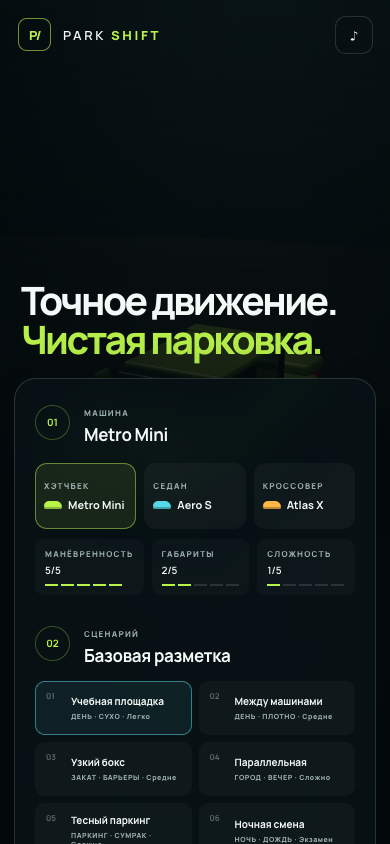

# PARK / SHIFT

**[Play online](https://andreashxc.github.io/park-shift-game/)** — runs in your browser; no installation required.

A small, fully procedural 3D parking simulator for the browser. Choose a car, learn its turning circle, and work through six parking challenges—from a quiet practice lot to a rainy night shift.



*An actual capture of the game during a driving session. The interface currently uses Russian; this README is in English.*

## What you can do

- Drive three fictional cars with different dimensions, acceleration and steering behavior.
- Play six scenarios with tight spaces, parallel parking, low light and rain.
- Switch between coaching with a trajectory guide and an expert mode without assists.
- Use four camera views, including a cockpit view and a reverse mirror.
- Track parking accuracy, collision penalties, stars and local personal bests.
- Play with a keyboard, touch controls or a compatible gamepad.

Cars, buildings, road markings, weather and sound are generated by the project. There are no downloaded vehicle models, accounts or application backend. Scores and preferences stay in this browser's local storage.

<details>
<summary>Mobile garage</summary>



Landscape is recommended for driving; portrait layouts are also supported.
</details>

## Run locally

Use **Node.js 22.12+** (verification used Node.js 24.10.0) and npm.

```bash
git clone https://github.com/andreashxc/park-shift-game.git
cd park-shift-game
npm ci
npm run dev
```

Build and serve the production version:

```bash
npm test
npm run preview
```

`npm test` runs the TypeScript and Vite production build. It is a build check, not a separate gameplay unit-test suite. Development and preview servers bind to `127.0.0.1` by default. The production output is a static site in `dist/`; the Pages build uses the project subdirectory base and local development uses the site root.

## Controls

| Action | Keyboard |
| --- | --- |
| Accelerate / brake | W / S or arrow keys |
| Steer | A / D or arrow keys |
| Change drive/reverse gear | R |
| Handbrake | Space |
| Change camera | C |
| Toggle coaching | H |
| Pause | Esc / P |

Touch controls provide steering, accelerator, brake and gear buttons. Gamepad support depends on the browser and controller mapping.

## Implementation

TypeScript, Three.js and Vite. The driving model uses a fixed simulation step, a kinematic bicycle model and oriented-box collision checks. The scene, driving HUD and local score storage live in `src/main.ts`; cars and scenarios are defined in `src/data.ts`.

Manrope is hosted locally with its SIL Open Font License. Three.js keeps its MIT license. See [third-party notices](THIRD_PARTY_NOTICES.md).

## Status and limits

This is a playable prototype. The production build and basic browser checks passed during release preparation: menu, session start, acceleration, rendering and desktop/mobile layouts. No console errors or external requests were observed in those checks. The dependency audit reported no known vulnerabilities on 2026-10-12.

These checks do not establish exhaustive gameplay, accessibility, device or performance coverage. The production bundle currently exceeds Vite's 500 kB warning threshold. There is no multiplayer, cloud save or native mobile app.

## Author and license

Created by **Andrew Manuilov** ([andreashxc](https://github.com/andreashxc)). This is the clean public edition of his original PARK / SHIFT project.

Original project: [andreashxc/park-shift-game](https://github.com/andreashxc/park-shift-game).

Original work is licensed under [Apache-2.0](LICENSE). Retain the applicable attribution and [NOTICE](NOTICE) when distributing it. Third-party components retain their separate licenses; see [AUTHORS](AUTHORS.md), [THIRD_PARTY_NOTICES](THIRD_PARTY_NOTICES.md) and [preparation changes](MODIFICATIONS.md).

## GitHub Pages

The Build, test and deploy workflow verifies the source, packages only dist/ and deploys it to GitHub Pages on pushes to main. Pull requests run checks without deployment. Static assets, fonts and image portraits use the project base path. No custom domain is configured by this project.
